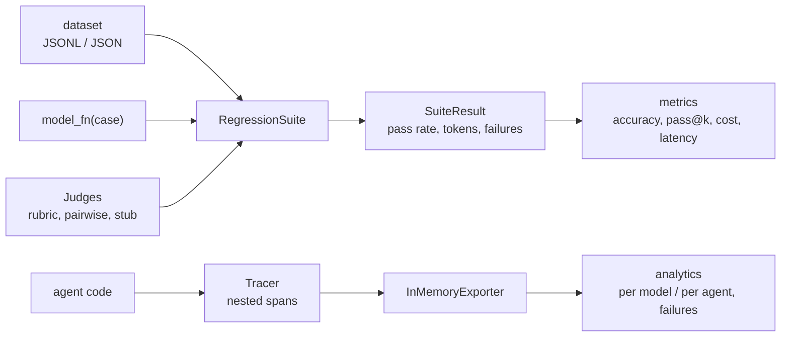

# Jagadish-llm-evals-observability

[](https://github.com/jagadishmazure-jpg/Jagadish-llm-evals-observability/actions/workflows/ci.yml)
[](https://github.com/jagadishmazure-jpg/Jagadish-llm-evals-observability/actions/workflows/codeql.yml)


**LLM evaluation and observability as code: judges (rubric, pairwise, offline stub), regression suites, quality and cost metrics, nested tracing, and per-agent cost and failure analytics. Offline, no API keys.**

> Personal learning and portfolio project. Everything runs offline on synthetic,
> fictional data with no API keys. Nothing is deployed. Numbers in this README
> come from real runs and are re-checked by CI (`scripts/render_docs.py --check`).

## Recruiter summary

- Shows how to put an LLM feature under test: a dataset, a model function, judges, a pass threshold, and token and cost accounting.
- Real run: a careful candidate passes 3/3 and a sloppy one 1/3 (one wrong answer, one timeout caught as a failure); a traced agent run shows tokens and cost per agent and the failing span.
- Deterministic offline tests; CI with lint, CodeQL, gitleaks and documented-output drift checks.

## Purpose

Without evals, "it worked in the demo" is the only quality signal, and without
traces nobody can say which agent or tool is slow, costly or failing. This repo
gives both as small libraries with stable interfaces, so a deterministic stub
judge in tests can be swapped for an LLM judge later. Methodology:
[docs/metrics.md](docs/metrics.md).

## Architecture



## How it works

- **Judges** (`evals/judges/`): a `Judge` protocol; `RubricJudge` validates 1-5
  scores per weighted criterion; `PairwiseJudge` returns A, B or tie;
  `OfflineStubJudge` scores keyword coverage of the reference.
- **Suites** (`evals/suites/`): load cases, run the model function, catch model
  exceptions as failures, apply judges at a threshold, and summarise.
- **Metrics** (`evals/metrics/`): accuracy, unbiased pass@k, token totals, cost
  from a per-1M-token price table, latency mean, p50 and p95.
- **Tracing** (`observability/tracing/`): `Tracer.start_span` context manager with
  parent links and automatic error capture.
- **Analytics** (`observability/analytics/`): cost and latency per model or agent,
  failure counts by error type and span name.

## Real code and output

```python
"""Compare two candidate 'models' on the demo set, then trace a small agent run and analyse it."""
from pathlib import Path

from evals.judges import OfflineStubJudge
from evals.metrics.cost import TokenUsage, estimate_cost_usd
from evals.metrics.quality import pass_at_k
from evals.suites import RegressionSuite, load_dataset
from evals.suites.runner import ModelOutput
from observability.analytics.aggregates import aggregate_by_agent, failure_breakdown
from observability.tracing.context import Tracer
from observability.tracing.exporters import InMemoryExporter

PRICING = {"model-small": (0.50, 1.50), "model-large": (5.00, 15.00)}  # illustrative USD per 1M tokens

cases = load_dataset(Path(__file__).with_name("demo.jsonl"))
ANSWERS = {"math-1": "The answer is 4.", "math-2": "10 / 2 = 5", "geo-1": "Paris is the capital of France."}


def careful(case):
    return ModelOutput(response=ANSWERS[case.id], prompt_tokens=40, completion_tokens=12)


def sloppy(case):
    if case.id == "math-2":
        return ModelOutput(response="It is 20.", prompt_tokens=40, completion_tokens=4)
    if case.id == "geo-1":
        raise TimeoutError("upstream timeout")
    return careful(case)


for name, fn, model in (("careful", careful, "model-large"), ("sloppy", sloppy, "model-small")):
    r = RegressionSuite(cases, fn, judges=[OfflineStubJudge()]).run()
    usage = TokenUsage(r.total_prompt_tokens, r.total_completion_tokens)
    cost = estimate_cost_usd(usage, model=model, pricing=PRICING).cost_usd
    print(f"{name:<8} pass rate {r.pass_rate:.0%} ({r.passed}/{r.total}), "
          f"tokens {usage.total_tokens}, est. cost ${cost:.6f} on {model}")
    for f in r.failures():
        print(f"         failed {f.case_id}: {f.error or 'judge score ' + format(f.judgment.score, '.2f')}")

print(f"pass@1 with 3 of 10 samples correct: {pass_at_k(10, 3, 1):.2f}; pass@5: {pass_at_k(10, 3, 5):.3f}")

exporter = InMemoryExporter()
tracer = Tracer(exporter)
with tracer.start_span("agent.run", agent="planner", model="model-large", prompt_tokens=300, completion_tokens=80):
    with tracer.start_span("llm.call", agent="researcher", model="model-small", prompt_tokens=900, completion_tokens=150):
        pass
    try:
        with tracer.start_span("tool.search", agent="researcher"):
            raise ConnectionError("search API unavailable")
    except ConnectionError:
        pass
for key, agg in sorted(aggregate_by_agent(exporter.spans, pricing=PRICING).items()):
    print(f"agent {key:<10} calls {agg.calls}, tokens {agg.prompt_tokens + agg.completion_tokens}, "
          f"est. cost ${agg.cost_usd:.6f}")
fb = failure_breakdown(exporter.spans)
print(f"spans {fb.total_spans}, failed {fb.failed_spans} ({fb.failure_rate:.0%}), by error {fb.by_error_type}, "
      f"by span {fb.by_span_name}")
```

Output of `python examples/demo.py` (real run, re-checked in CI):

<!-- run: python examples/demo.py -->
```text
careful  pass rate 100% (3/3), tokens 156, est. cost $0.001140 on model-large
sloppy   pass rate 33% (1/3), tokens 96, est. cost $0.000064 on model-small
         failed math-2: judge score 0.00
         failed geo-1: TimeoutError: upstream timeout
pass@1 with 3 of 10 samples correct: 0.30; pass@5: 0.917
agent planner    calls 1, tokens 380, est. cost $0.002700
agent researcher calls 2, tokens 1050, est. cost $0.000675
spans 3, failed 1 (33%), by error {'ConnectionError': 1}, by span {'tool.search': 1}
```
<!-- /run -->

## How to run

```bash
git clone https://github.com/jagadishmazure-jpg/Jagadish-llm-evals-observability.git
cd Jagadish-llm-evals-observability
python -m pip install pytest      # no runtime dependencies (uv users: uv sync --group dev)
python -m pytest -q          # offline, no keys
python examples/demo.py
python scripts/render_docs.py --check   # documented output still matches
```

Test suite size (real collection, re-checked in CI):

<!-- run: python scripts/count_tests.py -->
```text
0 tests collected
```
<!-- /run -->

## Guardrails

- A model exception becomes a recorded failure; the suite never crashes mid-run.
- Rubric scores outside 1-5 or of the wrong type raise instead of being averaged in.
- Spans record errors automatically, so failures show up in analytics.
- Unknown models fall back to default pricing in analytics instead of crashing; pass an explicit table for billing.

## Limitations

- The only built-in judge is a keyword-coverage stub; LLM judges are an interface, not an implementation.
- Prices in the demo are illustrative, and the default table has a single placeholder rate.
- Per-agent cost is priced using the first span's model in each group.
- Spans are kept in memory; no OpenTelemetry export yet.
- No PyPI release; install from source.

## Built vs planned

| Capability | Status | Where |
|---|---|---|
| Judge protocol, rubric, pairwise, stub | Built | `evals/judges/` |
| Regression suite runner | Built | `evals/suites/` |
| Quality, token, cost and latency metrics | Built | `evals/metrics/` |
| Tracer and in-memory exporter | Built | `observability/tracing/` |
| Cost, latency and failure analytics | Built | `observability/analytics/` |
| LLM-backed judge | Planned | docs/implementation-guide.md |
| OpenTelemetry / Application Insights exporter | Planned | not started |
| PyPI package | Planned | not started |

## Implementation guide

The step-by-step path from this offline build to an Azure deployment is in
[docs/implementation-guide.md](docs/implementation-guide.md). None of it has been
run; it is a plan.

## Related repositories

| Repo | How it relates |
|---|---|
| [Jagadish-agent-security-redteam](https://github.com/jagadishmazure-jpg/Jagadish-agent-security-redteam) | Security suite that fits the same regression pattern |
| [Jagadish-multi-agent-orchestration](https://github.com/jagadishmazure-jpg/Jagadish-multi-agent-orchestration) | Agents whose runs these traces describe |
| [Jagadish-agentic-rag](https://github.com/jagadishmazure-jpg/Jagadish-agentic-rag) | RAG-specific metrics (faithfulness, recall) |
| [Jagadish-dspy-prompt-optimizer](https://github.com/jagadishmazure-jpg/Jagadish-dspy-prompt-optimizer) | Uses a metric to choose prompts |
| [Jagadish-azure-finops](https://github.com/jagadishmazure-jpg/Jagadish-azure-finops) | Cost tracking at the cloud level |

## Documentation

- [Metrics methodology](docs/metrics.md)
- [Implementation guide (Azure)](docs/implementation-guide.md)
- [Interview points](docs/interview-points.md)
- [Security policy](SECURITY.md)

## Project layout

```
evals/
  judges/      Judge protocol, rubric, pairwise, stub
  suites/      datasets, runner, SuiteResult
  metrics/     quality, cost, latency
observability/
  tracing/     Span, Tracer, exporters
  analytics/   aggregates, failure breakdown
examples/      demo.jsonl + demo.py (the run shown above)
docs/          metrics.md
tests/         offline pytest suite
```

## License

MIT, see [LICENSE](LICENSE). All data is synthetic; every organisation and person is fictional.
